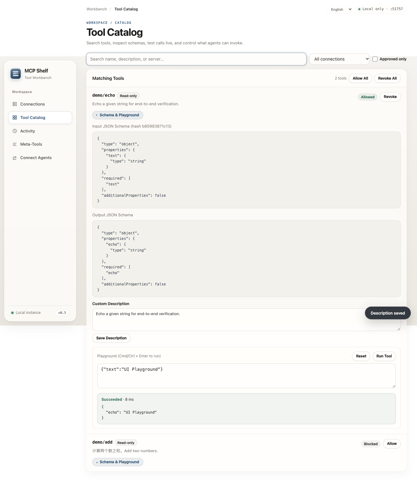

# MCP Shelf

> **English** · [简体中文](README.zh-CN.md)

[](https://nodejs.org/)
[](LICENSE)
[](#)
[](#internationalization)

**Configure MCP servers once. Share them across every AI agent — locally or self-hosted.**

MCP Shelf is a lightweight, zero-build Model Context Protocol (MCP) gateway and web workbench. Instead of duplicating upstream MCP configs across Grok Build, Codex, Claude Code, and Google Antigravity — or bloating every session with dozens of massive JSON tool schemas — each client registers **only MCP Shelf**.



## Why MCP Shelf?

| Problem | Traditional Setup (Direct MCPs) | MCP Shelf |
|---|---|---|
| Multi-agent config sprawl | Maintain separate configs for Grok, Codex, Claude, Antigravity | **Configure once, share everywhere** — with one-click JSON / Codex TOML import |
| Context window bloat | All upstream JSON schemas dumped into every turn | **Compact server summary + on-demand search** via 3 gateway meta-tools |
| "Blind" search gateways | Models don't know which servers exist unless prompted | **Auto-injected server summary** in MCP `initialize.instructions` and meta-tool descriptions |
| Security & governance | Upstream tools exposed all-or-nothing | **Deny-by-default allowlist**, Ajv schema validation, live playground, and activity log |
| Cross-device access | Tied to one machine | **Local & Remote modes** — run on loopback or deploy via Docker behind Caddy / NPM |

## How It Works (3 Meta-Tools)

| Meta-Tool | Purpose |
|---|---|
| `list_mcps` | Lists enabled upstream connections, status, approved tool counts, and previews. |
| `search_tool` | Searches approved upstream tools by keyword or exact `tool_id` (with CJK bigram fallback). Returns full `inputSchema` / `outputSchema` and a `how_to_call` hint by default (`include_schema: false` for compact names). |
| `call_tool` | Proxy-invokes one approved upstream tool by `server/tool` ID after local JSON Schema validation, preserving structured content and upstream error flags. |

Clients can receive `notifications/tools/list_changed` on the authenticated SSE stream opened with `GET /mcp` (or `GET /mcp/<profile>`). The stdio bridge forwards the same notification. Each `tools/list` request returns the current meta-tool descriptions. Run `search_tool` again to see edits to individual upstream tool descriptions. Clients that cache tool definitions and do not listen for notifications may need to reconnect. The summary in the model-facing tool definitions reflects configured approvals, so upstream discovery and health checks leave the prompt prefix stable. Use `list_mcps` or `search_tool` for current availability.

## Quick Start

Requires **Node.js 22+** (macOS / Linux).

```sh
git clone https://github.com/zhangtyzzz/mcp-shelf.git MCP-Shelf
cd MCP-Shelf
npm ci
```

### Option A: Local Gateway (Default `MCP_SHELF_MODE=local`)

```sh
npm start
```

Open **http://127.0.0.1:8787**:
1. In **Connections**, click **Templates** to one-click add classic servers (like free **Exa Search**, **Context7 Docs**, **Sequential Thinking**, or **GitHub OAuth**), or click **Import** to paste existing `mcpServers` JSON / Codex `config.toml`.
2. Click **Fetch Tools**, review and approve tools in **Tool Catalog**, and test them directly in the built-in **Playground**.
3. Open **Connect Agents**, copy the **Streamable HTTP** URL into your client, and sign in with OAuth 2.1 or set a Bearer token. Access profiles have their own URLs and credentials.

Optional global CLI link:

```sh
npm link
mcp-shelf          # Start local gateway
mcp-shelf config   # Print local config.json path
```

Custom port or config directory:

```sh
MCP_SHELF_PORT=8788 MCP_SHELF_HOME=~/.config/mcp-shelf-alt npm start
```

### Option B: Self-Hosted Docker Deployment (`MCP_SHELF_MODE=remote`)

Prebuilt multi-arch (`linux/amd64`, `linux/arm64`) images are automatically published to GHCR:
- `ghcr.io/zhangtyzzz/mcp-shelf:stable` / `:latest` — published from a formal `vX.Y.Z` tag after that commit passes protocol and browser CI.
- `ghcr.io/zhangtyzzz/mcp-shelf:master-<sha>` — builds from the `master` branch.
- `ghcr.io/zhangtyzzz/mcp-shelf:alpha` — preview builds from the `alpha` branch and `vX.Y.Z-alpha.N` tags.

Deploy MCP Shelf on your VPS behind **Caddy**, **Nginx Proxy Manager**, or **Cloudflare Tunnel** so all your devices share one authenticated MCP gateway:

```sh
export MCP_SHELF_ADMIN_PASSWORD=$(openssl rand -base64 24)
export MCP_SHELF_PUBLIC_URL=https://mcp.example.com

docker compose up -d
```

MCP Shelf OAuth access tokens default to 24 hours. Set `MCP_SHELF_OAUTH_ACCESS_TTL_SECONDS` in the Docker environment to override the lifetime for newly issued tokens. Previously issued access tokens keep their original expiry. OAuth clients that support token refresh can renew automatically. Refresh tokens rotate on use and expire 30 days after authorization.

See [deploy/Caddyfile.example](deploy/Caddyfile.example) for a 5-line automatic HTTPS reverse proxy config.

**Remote Mode Security:**
- Refuses to start unless `MCP_SHELF_ADMIN_PASSWORD` is at least 12 characters.
- Admin workbench protected by `scrypt` password verification, per-IP brute-force rate limiting (10 attempts / 15 min), and HMAC-SHA256 signed `HttpOnly; SameSite=Strict; Secure` session cookies.
- `/mcp` endpoint uses an independent 64-hex-char `Authorization: Bearer <TOKEN>` that can be revealed, copied, or rotated anytime from **Connect Agents**.

## Access profiles and upgrades

Choose **All enabled connections** or **Selected connections** for each access profile. An empty selection grants no connection access. Upgrading from v0.8.5 or earlier keeps the existing scope and credentials for each legacy profile and snapshots the original config to `config.v1.json` with mode `0600`.

Older releases reject the new config format at startup. To roll back, stop the gateway, save a copy of the current config, and review the snapshot for permissions or credentials revoked since the upgrade before restoring it as `config.json`. Start the old version with the restored config. Any changes made after the snapshot need to be reapplied.

## Internationalization

The web workbench ships with built-in, zero-dependency i18n (**English** default + **简体中文**), switchable live from the top bar. Adding another language only requires dropping a single dictionary file in `ui/locales/<code>.js` and registering it in [ui/i18n.js](ui/i18n.js) — see [CONTRIBUTING.md](CONTRIBUTING.md).

## Security Boundaries

- Config stored at `~/.config/mcp-shelf/config.json` (mode `0600`). Secrets are referenced by environment variable name only (`envKeys` / `bearerEnv`) and never written to disk or exported.
- Local mode binds strictly to `127.0.0.1` with `Host`, `Origin`, `Sec-Fetch-Site`, and CSRF checks.
- Newly discovered tools are blocked by default; changing upstream command, URL, or credential env names automatically resets approvals.
- Request body limit 1 MiB, upstream output limit 512 KB, discovery timeout 12s, tool call timeout 30s, no automatic write retries.

## Testing

```sh
npm test                          # Protocol, allowlist, import/export, remote auth & security tests
npm run test:ui                   # Playwright E2E (desktop/mobile, i18n, playground, live MCP)
node test/codex.mjs --roundtrip   # Codex CLI discovery & tool call roundtrip
node test/grok.mjs                # Grok Build CLI registration & doctor check
node test/claude.mjs              # Claude Code CLI connectivity check
```

## License

[MIT](LICENSE)
