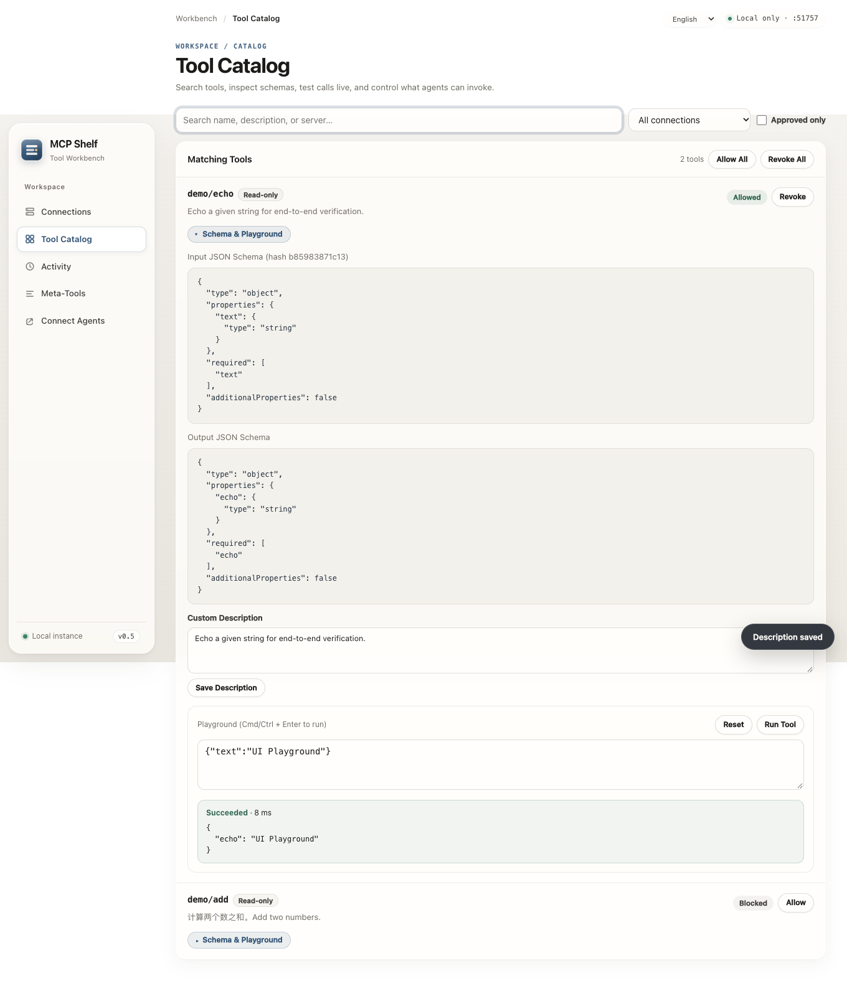

# MCP Shelf

> [English](README.md) · **简体中文**

[](https://nodejs.org/)
[](LICENSE)
[](#)

**一次配置 MCP，多个 Agent 共用。**

MCP Shelf 是一个轻量、零构建的本机 MCP 网关与可视化工作台。Codex、Claude Code、Google Antigravity 等客户端各自只需注册一个 `mcp-shelf` 服务，无需重复维护多份上游配置，也不会把几十个上游工具的庞大 JSON Schema 全量塞进 Agent 的初始上下文。



## 为什么选择 MCP Shelf？

| 痛点 | 传统做法（逐个直连 MCP） | MCP Shelf 方案 |
|---|---|---|
| 多客户端配置同步 | Codex / Claude / Antigravity 各自配一遍 | **一处配置、多端共用** |
| 上下文 Token 膨胀 | 上百个工具的完整 Schema 全部塞进首屏 | **动态精简服务摘要 + 按需搜索**：首屏只暴露 3 个元工具与一行式服务清单 |
| 模型“盲目”不知有哪些工具 | 纯搜索网关需要用户手动提醒 | **自动注入服务摘要**（MCP `instructions` + 元工具描述），开局即感知能力边界 |
| 工具权限与安全 | 上游全量开放，难审计 | **默认禁止、逐个/批量白名单**，Ajv 参数强校验、调用记录与在线试调 |

## 核心工作流（3 个元工具）

| 元工具 | 用途 |
|---|---|
| `list_mcps` | 列出已启用的上游连接、状态、已开放工具数与名称预览（描述自动附带当前服务摘要）。 |
| `search_tool` | 关键词或精确 `tool_id` 检索已开放工具；**默认直接附带完整 `inputSchema` / `outputSchema`**（传 `include_schema: false` 可切回精简列表），支持中英文模糊匹配。 |
| `call_tool` | 用 `连接ID/工具名` 与 JSON 参数调用已开放工具，经本机 JSON Schema 校验后转发，完整保留上游结构化内容与错误标记。 |

支持通知的 Streamable HTTP 客户端可在原地址用 `GET /mcp`（或 `GET /mcp/<权限组>`）打开经过鉴权的 SSE 流，接收 `notifications/tools/list_changed`。stdio 桥接也会转发该通知。每次 `tools/list` 返回最新的元工具描述，单个上游工具的描述在下次 `search_tool` 时读取。缓存工具定义且没有监听通知的客户端可能需要重连。提供给模型的连接摘要只使用已保存的连接与批准名单，上游探测和健康状态不会改写这部分提示词。实际可用工具以 `list_mcps` 和 `search_tool` 的结果为准。

连接摘要最多预览 20 个连接。详细描述超出字符预算时，会切换为精简的服务 ID 列表。可用 `list_mcps` 返回的 `next_offset` 分页查看完整目录。

## 快速开始

需要 **Node.js 22+**（macOS / Linux）。

```sh
git clone https://github.com/zhangtyzzz/mcp-shelf.git MCP-Shelf
cd MCP-Shelf
npm ci
```

### 方式 A：正式启动本机网关（默认 `MCP_SHELF_MODE=local`）

```sh
npm start
```

打开 **http://127.0.0.1:8787**：
1. 在 **连接管理** 选一个精选模板，或点击 **添加连接** 填写上游 URL 或本地启动命令。
2. 点击 **读取工具** 测试连接，在 **工具目录** 勾选要开放的工具。
3. 打开 **接入 Agent**，把 **Streamable HTTP** 地址复制到客户端，使用 OAuth 2.1 登录或配置 Bearer 令牌。每个权限组有独立的地址和凭据。

也可以全局链接为命令行工具：

```sh
npm link
mcp-shelf          # 正式启动
mcp-shelf config   # 打印本机配置文件路径
```

如默认端口 `8787` 被占用，可通过环境变量指定端口或配置目录：

```sh
MCP_SHELF_PORT=8788 MCP_SHELF_HOME=~/.config/mcp-shelf-alt npm start
```

### 方式 B：Docker 远程自部署（跨设备访问 + Caddy / NPM 反代）

GitHub Actions 自动构建并推送多架构（`linux/amd64`, `linux/arm64`）镜像至 GHCR：
- `ghcr.io/zhangtyzzz/mcp-shelf:stable` / `:latest` — 正式 `vX.Y.Z` 标签对应的提交通过协议和浏览器 CI 后发布。
- `ghcr.io/zhangtyzzz/mcp-shelf:master-<sha>` — `master` 分支构建。
- `ghcr.io/zhangtyzzz/mcp-shelf:alpha` — `alpha` 分支与 `vX.Y.Z-alpha.N` 标签的预览构建。

适合部署到你自己的 VPS / 服务器，前置于 Caddy、Nginx Proxy Manager 或 Cloudflare Tunnel 提供 HTTPS；部署后任意电脑的 Grok / Claude / Codex / Antigravity 都可以直连你的统一 MCP 网关：

```sh
# 1. 生成强管理密码（至少 12 位）
export MCP_SHELF_ADMIN_PASSWORD=$(openssl rand -base64 24)
export MCP_SHELF_PUBLIC_URL=https://mcp.example.com

# 2. 启动容器（默认拉取 :stable 镜像，仅监听宿主机 127.0.0.1:8787）
docker compose up -d
```

MCP Shelf 签给客户端的 OAuth 访问令牌默认有效 24 小时。可在 Docker 环境中设置 `MCP_SHELF_OAUTH_ACCESS_TTL_SECONDS`，调整新签发令牌的有效期。已签发的访问令牌按原时间到期。支持刷新令牌的 OAuth 客户端可以自动续期。刷新令牌每次使用都会轮换，有效期从首次授权起最长 30 天。

Caddy 反向代理示例见 [deploy/Caddyfile.example](deploy/Caddyfile.example)：

```caddy
mcp.example.com {
    reverse_proxy 127.0.0.1:8787 {
        flush_interval -1
    }
}
```

**远程模式安全机制：**
- 启用 `MCP_SHELF_MODE=remote`（或非回环绑定）时，**强制要求**至少 12 位的 `MCP_SHELF_ADMIN_PASSWORD`，未设置直接拒绝启动。
- 管理台使用 `scrypt` 校验密码 + 防爆破速率限制（15 分钟 10 次） + HMAC-SHA256 签名的 `HttpOnly; SameSite=Strict; Secure` Session Cookie。
- `/mcp` 支持 OAuth 2.1 或 64 位十六进制 Bearer 令牌。令牌可在「接入 Agent」页查看、复制和轮换。轮换后，使用旧令牌的设备立即失效。

## 管理台功能

1. **连接管理**：管理本地 `stdio` 与远程 `Streamable HTTP` 连接，支持模板、手动添加、Shelf 备份恢复和单个/全部刷新，自动预警缺失的环境变量名并给出清晰错误诊断。
2. **工具目录**：实时搜索（按 `/` 快速聚焦）、按连接/授权状态筛选、查看输入/输出 Schema 与 SHA-256 指纹、覆盖工具描述、批量允许/撤销，以及内置 **在线试调**（自动生成参数骨架，`Cmd/Ctrl + Enter` 执行）。
3. **调用记录**：查看本机网关内存中最近 200 条 Agent 与试调活动流水（耗时、状态、拦截原因），支持 3 秒自动刷新、按来源筛选与清空，不落盘敏感参数。
4. **元工具描述**：实时预览自动注入给 Agent 的精简服务摘要与目录指纹，自定义三个元工具文案或一键恢复默认。
5. **接入 Agent**：复制 Streamable HTTP 地址，查看和轮换令牌，管理权限组。

## 备份与恢复

在 **连接管理** 下载 Shelf 备份，保存连接、工具授权、设置、描述和权限组。恢复会用 Shelf 备份替换当前配置。同 ID 权限组沿用本机令牌。环境变量值、网关令牌和 OAuth 凭据由当前实例单独保存。

## 权限组与升级

权限组可选择「全部已启用连接」或「指定连接」。指定模式下，清空列表会撤销该组的连接访问权限。从 v0.8.5 或更早版本升级时，原权限和令牌会保留。网关会将旧配置备份为权限为 `0600` 的 `config.v1.json`。

旧版本会拒绝加载新格式。回滚时先停止网关并备份当前配置，检查快照中是否有升级后已撤销的权限或凭据，再将快照恢复为 `config.json` 后启动旧版本。快照之后的改动需要重新应用。

## 安全与边界

- **本地凭据隔离**：默认配置 `~/.config/mcp-shelf/config.json`（权限 `0600`），网关令牌可以在管理台按需查看。导出的连接 JSON 不包含令牌。
- **不存明文 Secret**：上游凭据通过环境变量名（`envKeys` / `bearerEnv`）引用。
- **四重本机管理台防护**：仅监听 `127.0.0.1`，严格校验 `Host`、`Origin`、`Sec-Fetch-Site` 与 `X-Shelf-CSRF`。请勿将管理台暴露至公网或共享网络。
- **最小权限原则**：新发现工具默认禁止；更改上游命令、URL 或凭据变量名会自动重置旧授权。`stdio` 进程继承当前系统用户权限，**请仅添加可信服务**。
- **调用约束**：输入请求上限 1 MiB，上游回包上限 512 KB，发现超时 12s，调用超时 30s，不自动重试写操作。

更多架构权衡与边界见 [设计说明](docs/design.zh-CN.md) 与 [验收记录](docs/verification.zh-CN.md)。

## 开发与测试

```sh
npm test                          # 全部协议、权限、备份恢复、搜索与安全集成测试
npm run test:ui                   # Playwright 浏览器 E2E（自动探测本机 Chrome/Chromium）
node test/codex.mjs --roundtrip   # Codex CLI 真实发现与工具调用往返（无需 API Key）
node test/grok.mjs                # Grok Build CLI 注册与 doctor 健康检查（需已安装 grok）
node test/claude.mjs              # Claude Code CLI 连接验证（需已安装 claude）
```

## License

[MIT](LICENSE)
